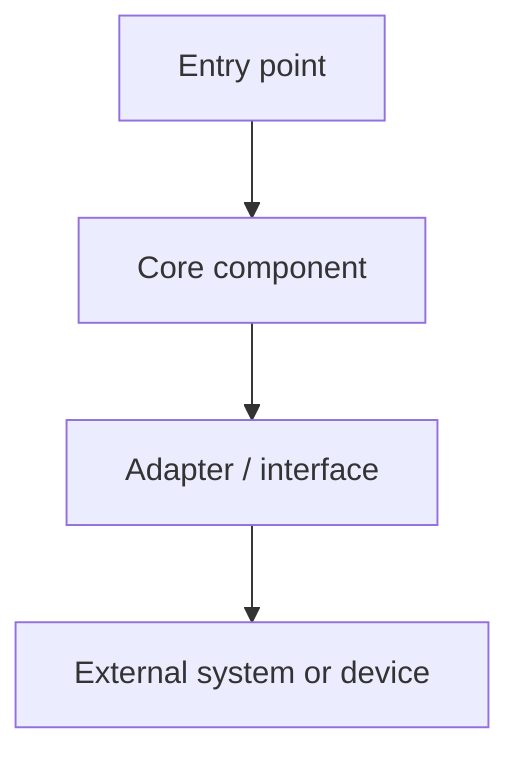
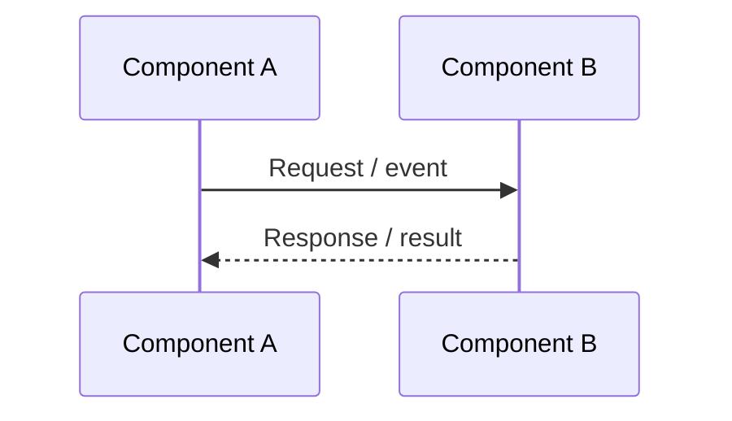

# System Architecture

> **Status:** Draft  
> **Owner:** [OWNER]  
> **Last updated:** [YYYY-MM-DD]  
> **Version:** [VERSION]

## 1. Architecture summary

Describe the major structural choices, deployment model, and runtime topology in a few paragraphs.

## 2. Architectural drivers

List the requirements and constraints that materially influence the design. Reference PRD requirement IDs and TRD constraints rather than duplicating them.

## 3. System context

Identify users, external systems, trust boundaries, and the system's responsibilities.

Replace the example with the actual context diagram.

## 4. Component architecture

| Component | Responsibility | Inputs | Outputs | Technology / runtime |
|---|---|---|---|---|
| [COMPONENT] | [RESPONSIBILITY] | [INPUTS] | [OUTPUTS] | [TECH] |

## 5. Runtime and deployment view

Document where components execute, how they are deployed, and what must be available at runtime.

- **Deployment units:** [UNITS]
- **Execution environments:** [ENVIRONMENTS]
- **Network boundaries:** [BOUNDARIES]
- **Startup and shutdown:** [LIFECYCLE]
- **Configuration:** [CONFIGURATION SOURCES]

## 6. Key sequence / data flows

Document critical paths, including failure and recovery paths. Link detailed message formats to [06_Protocol_and_Data_Schema.md](06_Protocol_and_Data_Schema.md).

## 7. State ownership and consistency

| State | Authoritative owner | Lifetime | Replication / consistency | Recovery |
|---|---|---|---|---|
| [STATE] | [OWNER] | [LIFETIME] | [RULE] | [RECOVERY] |

## 8. Failure modes and resilience

| Failure | Detection | System behaviour | Recovery / user impact |
|---|---|---|---|
| [FAILURE] | [DETECTION] | [BEHAVIOUR] | [RECOVERY] |

## 9. Observability

Define useful logs, metrics, traces, diagnostics, and privacy constraints.

| Signal | What it measures | Where emitted | Retention / privacy |
|---|---|---|---|
| [SIGNAL] | [PURPOSE] | [COMPONENT] | [RULE] |

## 10. Architecture constraints and trade-offs

Link important decisions to ADRs. Do not turn this document into a chronological decision log.

- [ADR-0001](../ADR/0001-decision-title.md): [DECISION SUMMARY]

## 11. Links

- TRD: [02_TRD.md](02_TRD.md)
- Protocol and schema: [06_Protocol_and_Data_Schema.md](06_Protocol_and_Data_Schema.md)
- Security: [08_Security.md](08_Security.md)
- Testing: [09_Testing.md](09_Testing.md)
