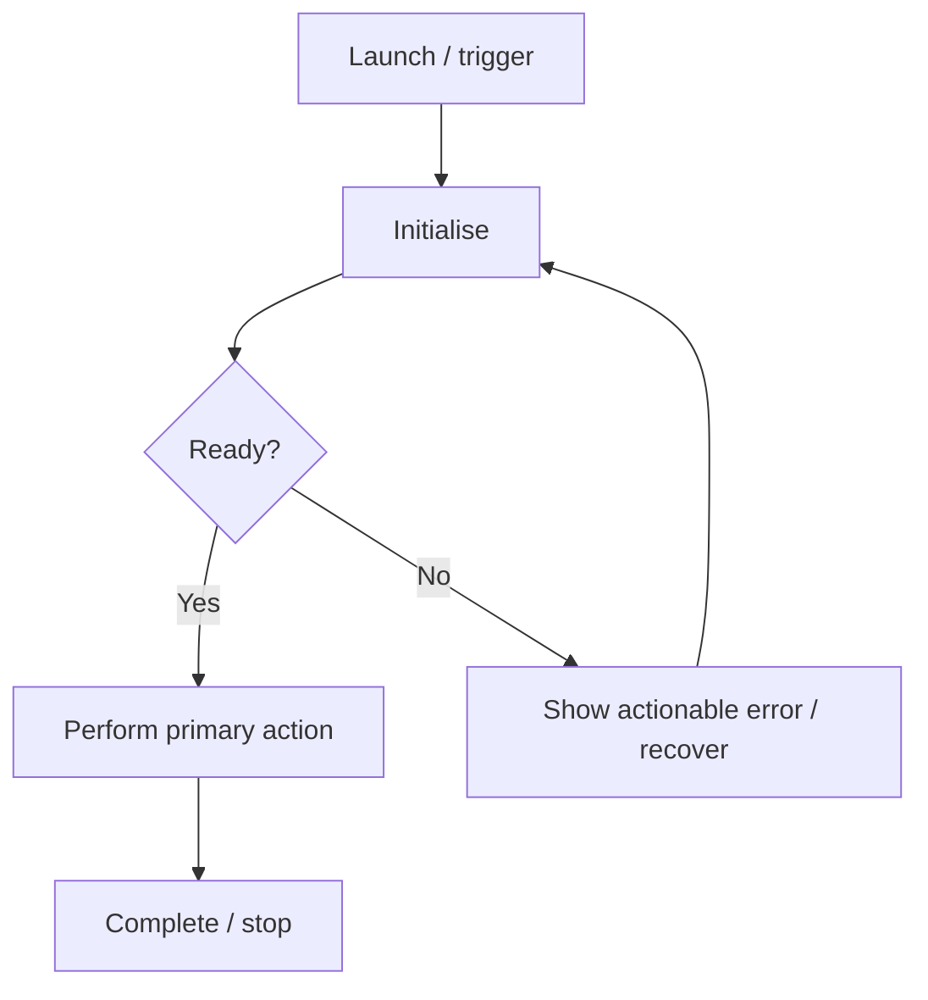

# Application and Operational Flow

> **Status:** Draft  
> **Owner:** [OWNER]  
> **Last updated:** [YYYY-MM-DD]

> For a headless system, replace user journeys with operator, API, device, or workflow lifecycles. If this document is not relevant, mark it N/A with a reason.

## 1. Entry points and actors

| Actor | Entry point | Goal | Permissions / prerequisites |
|---|---|---|---|
| [ACTOR] | [ENTRY] | [GOAL] | [PREREQUISITES] |

## 2. Primary journey

Describe the normal path from entry to completion.

## 3. State model

| State | Entry condition | Allowed actions / transitions | Exit condition |
|---|---|---|---|
| [STATE] | [CONDITION] | [TRANSITIONS] | [CONDITION] |

## 4. Alternate and failure flows

| Scenario | Trigger | Expected behaviour | Recovery / terminal state |
|---|---|---|---|
| Permission denied | [TRIGGER] | [BEHAVIOUR] | [RECOVERY] |
| Network unavailable | [TRIGGER] | [BEHAVIOUR] | [RECOVERY] |
| Unexpected interruption | [TRIGGER] | [BEHAVIOUR] | [RECOVERY] |

Remove scenarios that do not apply and add project-specific ones.

## 5. Lifecycle and lifecycle ownership

Describe startup, backgrounding, reconnection, shutdown, cleanup, and resource ownership as applicable.

## 6. Flow-to-requirement mapping

| Flow / state | PRD requirement IDs | Verification |
|---|---|---|
| [FLOW] | [FR-xxx] | [TEST ID] |
