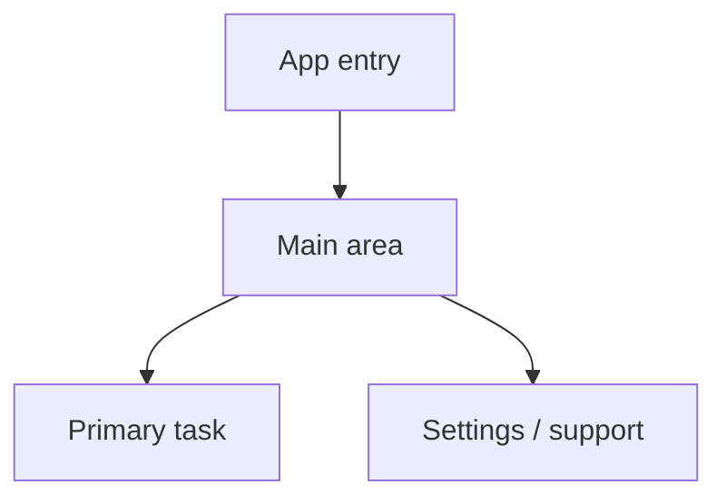

# UI / UX Design Brief

> **Status:** Draft  
> **Owner:** [OWNER / DESIGNER]  
> **Last updated:** [YYYY-MM-DD]

> If the project has no user interface, state **Not applicable** and explain which interface or operational documentation replaces this brief.

## 1. UX objectives

- Primary user outcome: [OUTCOME]
- Design principles: [PRINCIPLES]
- Usability constraints: [CONSTRAINTS]

## 2. Users and usage context

Describe user skill, environment, device constraints, accessibility needs, and usage frequency.

## 3. Information architecture

## 4. Screen inventory

| Screen / surface | Purpose | Primary actions | States to design |
|---|---|---|---|
| [SCREEN] | [PURPOSE] | [ACTIONS] | [LOADING / EMPTY / ERROR / SUCCESS] |

## 5. Screen specifications

### [SCREEN NAME]

- **Purpose:** [PURPOSE]
- **Content hierarchy:** [CONTENT]
- **Primary action:** [ACTION]
- **Secondary actions:** [ACTIONS]
- **Validation:** [RULES]
- **Loading / empty / error / success states:** [DETAILS]
- **Navigation:** [ENTRY AND EXIT]
- **Accessibility:** [KEYBOARD / SCREEN READER / CONTRAST / TEXT SCALING]

Repeat for each important screen.

## 6. Design system

- Typography: [TYPE SCALE]
- Colour: [TOKENS AND CONTRAST]
- Spacing: [GRID / SCALE]
- Components: [BUTTONS / INPUTS / CARDS / ETC.]
- Motion: [PURPOSE AND REDUCED-MOTION RULES]

## 7. Interaction and feedback

Specify feedback for user actions, asynchronous operations, destructive actions, permissions, and recoverable errors.

## 8. Responsive and platform behaviour

Document breakpoints, orientation, device classes, platform conventions, and input methods.

## 9. Design assets and references

- Design source: [LINK]
- Assets: [LOCATION]
- Brand / product references: [LINKS]
