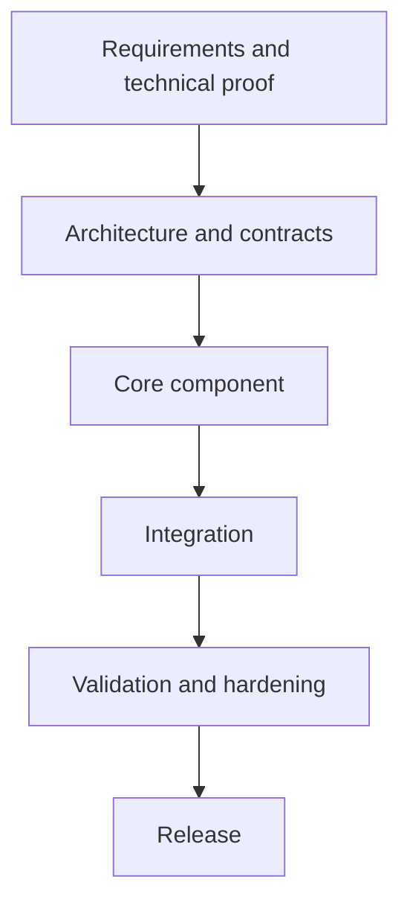

# Implementation Plan

> **Status:** Draft  
> **Owner:** [OWNER]  
> **Last updated:** [YYYY-MM-DD]

## 1. Delivery strategy

Describe the incremental delivery approach and the smallest end-to-end proof of the core value.

## 2. Work breakdown

| Phase | Objective | Deliverables | Dependencies | Exit criteria |
|---|---|---|---|---|
| 0. Foundation | [OBJECTIVE] | [DELIVERABLES] | [DEPENDENCIES] | [VERIFIABLE EXIT] |
| 1. Core vertical slice | [OBJECTIVE] | [DELIVERABLES] | [DEPENDENCIES] | [VERIFIABLE EXIT] |
| 2. Feature completion | [OBJECTIVE] | [DELIVERABLES] | [DEPENDENCIES] | [VERIFIABLE EXIT] |
| 3. Hardening | [OBJECTIVE] | [DELIVERABLES] | [DEPENDENCIES] | [VERIFIABLE EXIT] |
| 4. Release | [OBJECTIVE] | [DELIVERABLES] | [DEPENDENCIES] | [VERIFIABLE EXIT] |

## 3. Dependency order

Identify tasks that cannot start until interfaces, hardware, permissions, or upstream components are ready.

## 4. Milestones

| Milestone | Target date | Completion evidence | Status |
|---|---|---|---|
| [MILESTONE] | [YYYY-MM-DD] | [DEMO / TEST / RELEASE] | [NOT STARTED / IN PROGRESS / DONE] |

## 5. Work tracking

Use the issue tracker or project board for task-level status. Avoid duplicating a full task list here.

- Project board: [LINK]
- Issues: [LINK]
- CI: [LINK]

## 6. Definition of done

A work item is done when:
- Acceptance criteria are met.
- Automated and relevant manual tests pass.
- Security and privacy implications are addressed.
- Documentation and contracts are updated.
- Review is complete and the change is integrated.

## 7. Risks and contingencies

| Risk | Trigger | Impact | Mitigation / fallback |
|---|---|---|---|
| [RISK] | [TRIGGER] | [IMPACT] | [MITIGATION] |
